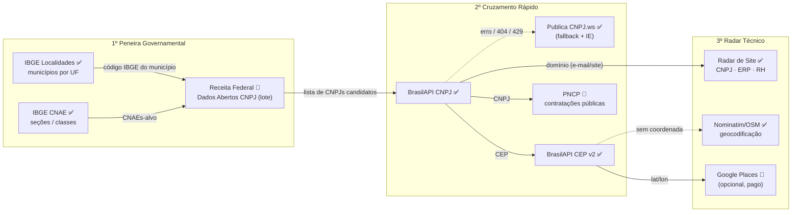

# Fluxo de Dados — Funil de Cruzamento em 3 Estágios

> Etapa 1 · `mcp-dados-brasil` · camada 100% determinística (nenhuma etapa depende de IA para funcionar).
> Status: ✅ = conector implementado nesta etapa · 📄 = apenas documentado (conector previsto para a Etapa 2).



**Ideia do funil:** cada estágio é mais caro (mais chamadas, mais lento, mais limitado por taxa) que o anterior.
Por isso o 1º estágio reduz o universo usando bases oficiais em lote, o 2º enriquece só os candidatos que sobraram,
e o 3º faz a inspeção técnica (site, geolocalização) apenas nos CNPJs já qualificados.

---

## 1º Estágio — Peneira Governamental

### IBGE Localidades ✅ `src/conectores/ibge.js` → ferramenta `ibge_municipios_cnaes` (tipo=`municipios`)

| Item | Valor |
|---|---|
| URL | `https://servicodados.ibge.gov.br/api/v1/localidades/estados/{UF}/municipios` |
| Entrada | `uf` (sigla, padrão `MS`) |
| Saída | `uf`, `total` (MS = **79**), `municipios[]: { id (código IBGE 7 dígitos), nome, microrregiao, mesorregiao, regiaoImediata, regiaoIntermediaria }` |
| Limite | sem limite documentado · cache local 30 dias (`data/cache/ibge/`) |

### IBGE CNAE ✅ `src/conectores/ibge.js` → ferramenta `ibge_municipios_cnaes` (tipo=`cnae`)

| Item | Valor |
|---|---|
| URLs | `https://servicodados.ibge.gov.br/api/v2/cnae/secoes` · `https://servicodados.ibge.gov.br/api/v2/cnae/classes` |
| Entrada | `secao` opcional (`A`..`U`) |
| Saída | sem seção: `secoes[]: { id, descricao }` (21) · com seção: `classes[]: { id (5 dígitos), descricao, grupo, divisao, secao, secaoDescricao }` |
| Limite | sem limite documentado · cache 30 dias |

### Receita Federal — Dados Abertos CNPJ 📄 (Etapa 2)

| Item | Valor |
|---|---|
| URL | `https://arquivos.receitafederal.gov.br/dados/cnpj/dados_abertos_cnpj/` (arquivos `Empresas*.zip`, `Estabelecimentos*.zip`, `Simples.zip`, `Cnaes.zip`, `Municipios.zip`; atualização mensal — confirmar caminho vigente antes de implementar) |
| Entrada | filtros: município (código **TOM/SIAFI** da Receita, não o código IBGE → requer tabela de-para), CNAE fiscal, situação cadastral = 02 (ativa), porte |
| Saída | lista de CNPJs candidatos (básico + ordem + DV), CNAE, porte, situação, endereço |
| Observação | ingestão em lote (CSV `;`, Latin-1) — não é API em tempo real |

---

## 2º Estágio — Cruzamento Rápido

### BrasilAPI CNPJ ✅ `src/conectores/cnpj.js` → ferramenta `consultar_cnpj_real`

| Item | Valor |
|---|---|
| URL | `https://brasilapi.com.br/api/cnpj/v1/{cnpj}` |
| Entrada | `cnpj` (com/sem máscara; numérico ou **alfanumérico**) — validado localmente antes de qualquer chamada |
| Campos lidos | `razao_social`, `nome_fantasia`, `identificador_matriz_filial`, `descricao_situacao_cadastral`, `data_inicio_atividade`, `codigo_porte`, `codigo_natureza_juridica`, `opcao_pelo_mei`, `capital_social`, `cnae_fiscal(+_descricao)`, `cnaes_secundarios`, endereço, `ddd_telefone_1`, `email` |
| Fallback | qualquer erro (4xx/5xx/timeout) → Publica CNPJ.ws |

### Publica CNPJ.ws ✅ (fallback + Inscrição Estadual)

| Item | Valor |
|---|---|
| URL | `https://publica.cnpj.ws/cnpj/{cnpj}` |
| Limite | **3 consultas/minuto** → throttle de 20 s (`CNPJWS_INTERVALO_MS`) |
| Uso | (a) fallback completo quando a BrasilAPI falha; (b) 2ª chamada só para trazer `estabelecimento.inscricoes_estaduais` (parâmetro `incluir_ie`, padrão `true`) |

**Saída normalizada (mesma para as duas fontes):**

```
cnpj, cnpjFormatado, razaoSocial, nomeFantasia, matrizFilial (MATRIZ|FILIAL), situacao, dataAbertura,
porte (ME|EPP|DEMAIS|NAO_INFORMADO), porteDescricao, naturezaJuridica{codigo,descricao}, mei,
capitalSocial, cnaePrincipal{codigo,descricao}, cnaesSecundarios[], endereco{logradouro,numero,
complemento,bairro,cep,municipio,uf,codigoIbge}, inscricoesEstaduais[{inscricao,uf,ativa}] | null,
telefone, email, contatoMotivo, fonte (brasilapi | cnpjws | brasilapi+cnpjws), consultadoEm, avisos[]
```

**Regra LGPD de contato (telefone/e-mail):** expostos **somente** se
`porte ∈ {DEMAIS, EPP}` **e** natureza jurídica empresarial PJ (códigos `2xxx`: Ltda, S.A., SLU, economia mista…)
**e** não for `213-5 Empresário (Individual)` **e** não for optante do MEI.
Caso contrário `telefone = email = null` e `contatoMotivo` explica (`oculto_porte`, `oculto_mei`,
`oculto_empresario_individual`, `oculto_natureza_nao_empresarial`).

Cache: `data/cache/cnpj/{cnpj}.json`, TTL 7 dias.

### BrasilAPI CEP v2 ✅ `src/conectores/geo.js` → ferramenta `geocodificar_cep`

| Item | Valor |
|---|---|
| URL | `https://brasilapi.com.br/api/cep/v2/{cep}` |
| Entrada | `cep` (8 dígitos) ou `endereco` livre; `precisao_rua` opcional |
| Saída | `cep, logradouro, bairro, cidade, uf, codigoIbge, lat, lon, precisao, fonte` |
| Atenção | as coordenadas da BrasilAPI costumam ser o **centróide do município** (CEPs diferentes da mesma cidade devolvem o mesmo ponto) → `precisao = "cep_aproximado"`. Para ponto da rua use `precisao_rua=true` (Nominatim). |
| Cache | `data/cache/geo/`, sem expiração |

### PNCP — Portal Nacional de Contratações Públicas 📄 (Etapa 2)

| Item | Valor |
|---|---|
| Documentação | `https://pncp.gov.br/api/consulta/swagger-ui/index.html` |
| URLs | `https://pncp.gov.br/api/consulta/v1/contratacoes/publicacao?dataInicial=AAAAMMDD&dataFinal=AAAAMMDD&codigoModalidadeContratacao={n}&uf={UF}&pagina={p}` · `https://pncp.gov.br/api/consulta/v1/contratos?dataInicial=AAAAMMDD&dataFinal=AAAAMMDD&pagina={p}` |
| Entrada | período, UF / código IBGE do município, modalidade |
| Saída | contratações e contratos (órgão, objeto, valores, **CNPJ do fornecedor** em contratos) → cruzar com CNPJs do 1º estágio para sinal "vende para governo" |
| Observação | paginado; respeitar intervalo entre páginas |

---

## 3º Estágio — Radar Técnico

### Radar de Site ✅ `src/conectores/site-radar.js` → ferramenta `inspecionar_site_erp`

| Item | Valor |
|---|---|
| URL | `https://{dominio}/` (fallback `http://`), GET simples, **timeout 5 s**, máx. 2 MB, sem executar JavaScript |
| Entrada | `dominio` (ou URL completa); endereços locais/privados são bloqueados |
| Saída | `dominio, acessivel, urlFinal, status, titulo, cnpjs[{cnpj,formatado}], erps[{nome,evidencia}], rh[{nome,evidencia}], trabalheConosco{evidencia}|null, indicioMedioGrande, avisos[]` |

Assinaturas (regex específicas — ex.: `sap` não casa com "whatsapp"):

| Grupo | Sinais |
|---|---|
| CNPJ | máscara `NN.NNN.NNN/NNNN-DD` (aceita alfanumérico) ou 14 dígitos logo após "CNPJ"; todos validados pelo DV |
| ERP | totvs, protheus, sankhya, sap, senior, linx, omie, bling, alterdata |
| RH (→ `indicioMedioGrande`, +40 func.) | gupy.io, solides, vagas.com, inhire, kenoby |
| RH (sinal fraco, não marca porte) | link/texto "trabalhe conosco", `/carreiras` |

### Nominatim / OpenStreetMap ✅ (fallback de geocodificação)

| Item | Valor |
|---|---|
| URL | `https://nominatim.openstreetmap.org/search?format=jsonv2&countrycodes=br&limit=1&…` (`street`+`city`+`state`, `postalcode`, `city` ou `q`) |
| Limite | **1 req/s** (throttle `NOMINATIM_INTERVALO_MS`), User-Agent identificável, `NOMINATIM_EMAIL` opcional |
| Saída | `lat, lon, precisao (endereco | cep | cidade)` |

### Google Places 📄 (Etapa 2, opcional)

| Item | Valor |
|---|---|
| URL | `https://places.googleapis.com/v1/places:searchText` (POST, header `X-Goog-Api-Key`, `X-Goog-FieldMask`) |
| Entrada | razão social / fantasia + cidade, ou lat/lon do estágio 2 |
| Saída | `displayName, formattedAddress, location, websiteUri, nationalPhoneNumber, rating, userRatingCount` → descobrir domínio para o Radar de Site |
| Observação | API paga, requer chave — manter desligado por padrão |

---

## Ferramentas MCP expostas (stdio)

| Ferramenta | Conector | Estágio |
|---|---|---|
| `ibge_municipios_cnaes` | `ibge.js` | 1º |
| `consultar_cnpj_real` | `cnpj.js` | 2º |
| `geocodificar_cep` | `geo.js` | 2º / 3º |
| `inspecionar_site_erp` | `site-radar.js` | 3º |

Configuração em `.mcp.json` (raiz). Testes: `npm test` (offline, fixtures) e `npm run test:live` ou `LIVE=1 npm test` (APIs reais).

---

## Persistência — Supabase/PostgreSQL (Etapa 2)

O banco é a **fonte da verdade**. Tudo vive no schema privado `prospeccao` (fora da Data API; `anon`/`authenticated`/`service_role` sem acesso).

| Arquivo | Papel |
|---|---|
| `db/migracoes/001_inicial.sql` | DDL: 5 tabelas, funções `cnpj_valido`/`contem_cpf`/`org_atual`, gatilhos, RLS |
| `src/db/conexao.js` | `pg` + SSL (com `DATABASE_URL`) ou PGlite em memória (testes) |
| `src/db/migracoes.js` | executor idempotente (sha256 por arquivo, advisory lock, 1 transação por arquivo) |
| `src/db/repositorio.js` | única porta de leitura/escrita (Zod em `src/db/esquemas.js`) |
| `npm run db:status` / `db:migrar [-- --dry-run]` | diagnóstico / aplicar migrações |
| ferramenta MCP `db_status` | mesmo diagnóstico via MCP, sem expor credenciais |

**Isolamento:** `FORCE ROW LEVEL SECURITY` em todas as tabelas. O repositório roda cada operação com
`SET LOCAL ROLE prospeccao_app` + `set_config('app.organization_id', …, true)`; sem organização definida, o app não vê nada.
FKs compostas `(organization_id, empresa_id)` impedem vincular dados entre organizações.

**Anti-invenção (garantido por CHECK no banco):** CNPJ só com DV válido; telefone/e-mail/coordenada presentes exigem
origem (`telefone_origem`, `email_origem`, `geo_fonte` + `geo_precisao`); ausência = `NULL` + `NAO_VERIFICADO`;
sinal de ERP/RH `CONFIRMADO` exige trecho literal + URL; **não existe coluna de número de funcionários**
(`indicio_medio_grande` é derivado de sinal de RH confirmado).

**LGPD:** sem colunas de sócio/QSA/CPF/nome de pessoa; MEI, Empresário Individual (213-5), natureza não empresarial e
porte ME são recusados (escopo: PJ EPP/DEMAIS); razão social/fantasia com CPF é recusada.
`nao_contatar` é **global e permanente** (sem DELETE/UPDATE para o app; gatilho barra até o dono):
CNPJ bloqueado → INSERT recusado e linhas existentes saneadas (`etapa_funil = bloqueado_lgpd`); telefone bloqueado →
gravado como `NULL` / `BLOQUEADO_LGPD`; leituras do repositório ocultam ambos.

**Funil:** `empresas.etapa_funil` é o estado atual; toda mudança gera linha em `funil_historico` (somente-inserção) por gatilho.

**Migrações:** nunca edite um arquivo já aplicado — o executor detecta a mudança de sha256 e aborta; crie `002_….sql`.
